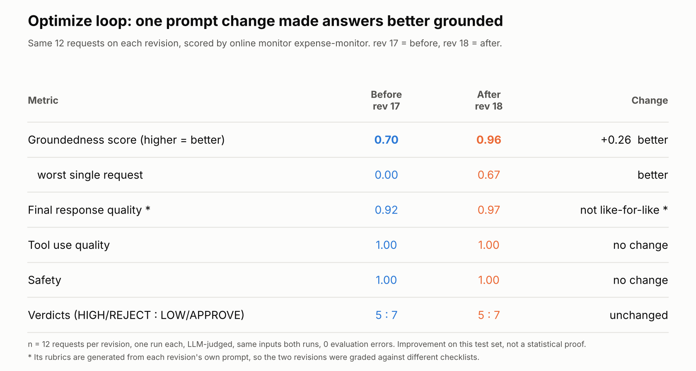
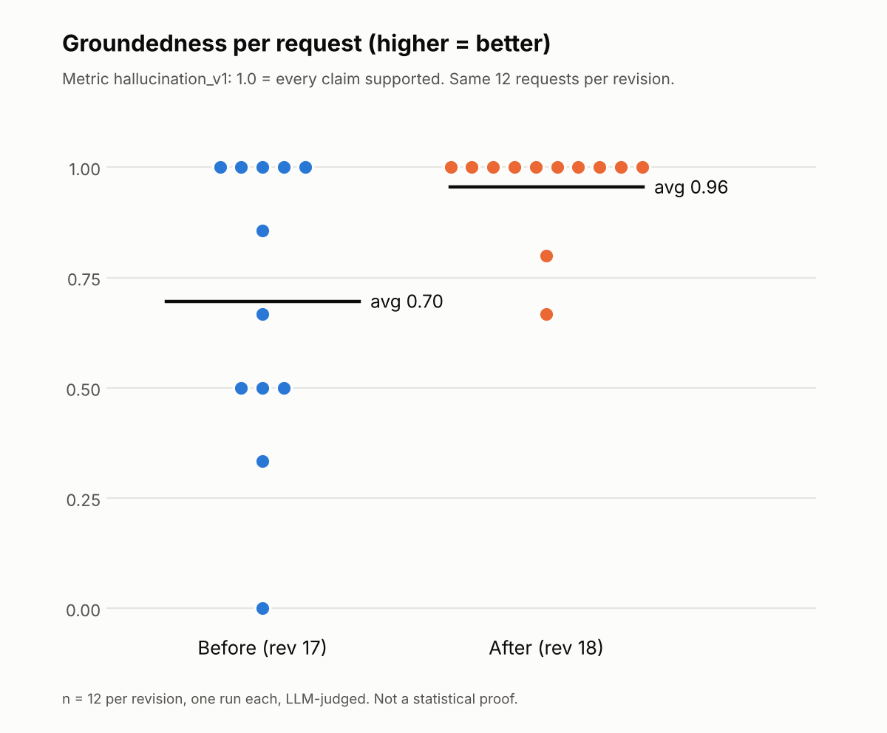

# Observe and optimize: online monitor and a measured prompt change

How the deployed engine was made observable enough for an **online monitor** to score live traffic, and how one prompt change was measured with it. Same throwaway project as [governance-setup.md](governance-setup.md) (`jzhuo08-demo`, `us-east1`, no organization). Git tags: `v5-observable` (monitor working), `v6-optimized` (the prompt change).

| Item | Value used in this repo |
|---|---|
| Engine | `projects/444323067071/locations/us-east1/reasoningEngines/7197127138003124224` (behind `expense-ingress-gateway`) |
| Online monitor | `expense-monitor` |
| Metrics | `final_response_quality_v1`, `tool_use_quality_v1`, `hallucination_v1`, `safety_v1` |
| Sampling | 100%, up to 50 traces per run; runs about every 10 minutes |

**Read `hallucination_v1` as groundedness.** The score is the share of claims supported by the context: 1.0 means fully grounded, so **higher is better**.

## Two kinds of evaluation in this repo

| | Pre-deploy gate (`v3-eval-gate`) | Online monitor (`v5-observable`) |
|---|---|---|
| When | Before deploy, `make predeploy` | Continuously, on live traces |
| Input | A fixed eval set you wrote | Whatever traffic arrives |
| Can block a deploy | Yes | No, it reports |
| Deterministic check | `raw_pii_absent` | None |

The gate tests what you thought of. The monitor scores what actually happens.

## What the monitor needs, and how each gap showed up

The monitor reads `call_llm` spans and needs the system instruction, tool definitions, input and output messages in them. Each fix below came from an error or an empty result.

| # | Requirement | Where | Symptom without it |
|---|---|---|---|
| 1 | Export spans: `otel_to_cloud = True` | `app/fast_api_app.py` | No traces to score |
| 2 | `enable_tracing=True` on `AdkApp` | `app/app_utils/reasoning_engine_adapter.py` | The SDK's `AdkApp.set_up()` forces `ADK_CAPTURE_MESSAGE_CONTENT_IN_SPANS` to `false` unless `enable_tracing` is set, overwriting the deploy env var. Spans have no content. |
| 3 | Capture content in spans and events, upload hook off | Deploy env vars (below) | With the default `upload` hook, inline content is replaced by `_ref` labels pointing to GCS |
| 4 | At least one tool on the LLM agent | `expense_agent/agent.py` (`lookup_expense_policy`) | `tools not present in any call_llm span` |
| 5 | Name every env var on every deploy | Deploy command | `agents-cli deploy --update-env-vars` resets the vars you leave out |
| 6 | Stay under the judge model's quota | Traffic volume | `EVALUATION_ERROR: Judge model resource exhausted` |

### Env vars for content capture

These are the values that differ from the scaffold's defaults (which are `NO_CONTENT`, `false` and `upload`):

```
OTEL_INSTRUMENTATION_GENAI_CAPTURE_MESSAGE_CONTENT=SPAN_AND_EVENT
ADK_CAPTURE_MESSAGE_CONTENT_IN_SPANS=true
ADK_TELEMETRY_IGNORE_RUN_CONFIG=true
OTEL_INSTRUMENTATION_GENAI_COMPLETION_HOOK=none
```

The deploy that turned them on (it keeps Agent Identity and the gateway binding from [governance-setup.md](governance-setup.md)):

```bash
agents-cli deploy --project=jzhuo08-demo --region=us-east1 \
  --deployment-target=agent_runtime --agent-identity --update-only \
  --agent-gateway-ingress=projects/444323067071/locations/us-east1/agentGateways/expense-ingress-gateway \
  --update-env-vars OTEL_INSTRUMENTATION_GENAI_CAPTURE_MESSAGE_CONTENT=SPAN_AND_EVENT,ADK_CAPTURE_MESSAGE_CONTENT_IN_SPANS=true,OTEL_INSTRUMENTATION_GENAI_COMPLETION_HOOK=none,ADK_TELEMETRY_IGNORE_RUN_CONFIG=true
```

`--update-env-vars` resets the vars you leave out, so repeat all four on every later deploy, or capture silently goes back to the defaults and the monitor stops scoring. Confirm afterwards:

```bash
ENG=projects/444323067071/locations/us-east1/reasoningEngines/7197127138003124224
curl -s -H "Authorization: Bearer $(gcloud auth print-access-token)" \
  "https://us-east1-aiplatform.googleapis.com/v1beta1/$ENG" \
  | jq '{identity: .spec.identityType, gateway: .spec.deploymentSpec.agentGatewayConfig,
         env: [.spec.deploymentSpec.env[] | select(.name | test("CAPTURE|HOOK|IGNORE_RUN"))]}'
```

### The privacy tradeoff

The monitor only works with prompt and response content in the traces. Setting capture back to `NO_CONTENT` / `false` / `upload` turns the scoring off. In a real system, redact before content is captured (the agent's own scrub, plus an edge detector), and decide who can read the traces.

### Judge quota

A burst of 30 requests (x 4 metrics) gave 82 result entries, 20 of them `Judge model resource exhausted`. Batches of 12 requests per monitor window gave 0 errors. The limit appears to apply per monitor run, so spreading a burst over a few seconds does not help; spread it over windows.

## Send traffic and read the scores

```bash
# 12 requests that all reach the model (amounts >= $100), same requests every run
uv run python scripts/generate_online_traffic.py --review-only --n 12 --delay 2
```

Wait for the next monitor run (about 10 minutes), then read the results from Cloud Logging. Replace the timestamp with the time you sent the traffic (UTC):

```bash
gcloud logging read \
  'logName="projects/jzhuo08-demo/logs/aiplatform.googleapis.com%2Fonline_evaluator" AND timestamp>="2026-10-12T10:00:00Z"' \
  --project=jzhuo08-demo --limit=500 --format=json > scores.json

jq -r '.[] | select(.labels["event.name"] == "gen_ai.evaluation.result")
  | [.labels["runtime_revision_id"], .labels["gen_ai.evaluation.name"], .labels["gen_ai.evaluation.score.value"]] | @tsv' \
  scores.json | sort | head -60
```

Where things are in a result entry:

- `labels`: `event.name` (`gen_ai.evaluation.result`), `gen_ai.evaluation.name`, `gen_ai.evaluation.score.value`, `runtime_revision_id`, `gen_ai.conversation.id`.
- `jsonPayload.candidateResult.rubricVerdicts`: for rubric-based metrics, each rubric the judge checked, its verdict and its reasoning. This is the fastest way to see why a request scored low.

Filter on `event.name` in `jq`, not in the `gcloud` filter: the quoted label key in the filter returned nothing. The monitor also writes a status entry every run (labels only, no score), so a plain `--limit` on recent entries can return only those; use a timestamp window. Error entries carry `EVALUATION_ERROR` in the explanation.

## The optimize loop: one change, measured

**Change** (`v6-optimized`, commit `05bad66`): revision 17 already called `lookup_expense_policy` (added in `v5-observable`) and compared the amount to the returned limit. The change adds four sentences to the risk reviewer's instruction: write the summary using only facts from the report and the tool result, quote the amount, category and policy limit, do not speculate about intent or the purchasing process, and do not comment on the wording of the description. Nothing else changed: same model, same tool.

**Method:** the same 12 requests (`--n 12 --review-only`, fixed seed) sent to revision 17 (before) and revision 18 (after), scored by the same monitor. Same model on both revisions; this is not a model comparison.

| Metric (higher is better) | Before, rev 17 | After, rev 18 |
|---|---|---|
| Groundedness (`hallucination_v1`), average | 0.70 | 0.96 |
| Groundedness, worst request | 0.00 | 0.67 |
| Final response quality, average | 0.92 | 0.97 |
| Final response quality, worst request | 0.60 | 0.857 |
| Tool use quality | 1.0 | 1.0 |
| Safety | 1.0 | 1.0 |
| Verdicts (HIGH/REJECT : LOW/APPROVE) | 5 : 7 | 5 : 7 |
| Evaluation errors | 0 | 0 |

The decisions did not change; the explanations became better grounded.





**Limits.** 12 requests, one run per revision, scored by LLM judges. This is evidence on this test set, not statistical proof. The groundedness judge penalizes opinions, speculation and verdict labels, and one baseline score of 0 looked partly like a judge quirk.

**Final response quality is not a fixed yardstick.** Its rubrics are generated from the agent's own instructions: on revision 18 they include "the summary includes the expense amount, the expense category, and the policy limit" and "does not speculate about the submitter's intent", which are lines from the new prompt. So revision 17 and revision 18 were each graded against their own prompt's rubrics. Read the 0.92 to 0.97 change as "each revision does what its prompt asks", not as a like-for-like comparison. Groundedness, tool use and safety do not depend on the prompt's wording in the same way, so groundedness is the headline number. To see the rubrics each revision was judged on:

```bash
jq -r '.[] | select(.labels["gen_ai.evaluation.name"] == "final_response_quality_v1")
  | .labels["runtime_revision_id"] as $r
  | .jsonPayload.candidateResult.rubricVerdicts[]?.evaluatedRubric.content.property.description
  | "\($r)\t\(.)"' scores.json | sort -u
```

## Open findings

1. **A Model Armor response-path span said "Fail-Open Configured".** On a $12.50 auto-approved request, a response-path span showed `501 Unsupported Input` with reason `Fail-Open Configured`, and there was no `SANITIZE_MODEL_RESPONSE` entry in the Model Armor log for that request. The live authorization extension is `failOpen: false` (gcloud omits the field when false) and the template has no such setting. It appeared on 1 of 18 screened responses. Cause unknown; whether that response was screened is unknown.
2. **A second response-path span** returned allow (200) but was still flagged Error. Unexplained.
3. **Content capture stays on** while the monitor runs (see the tradeoff above).
4. **Duplicate monitors** were created while debugging; delete the extras.

## Cleanup

- Delete the online monitor(s) when done; they keep calling the judge model.
- To stop capturing content, redeploy with the full env set and `NO_CONTENT` / `false` / `upload` (or `none`). This stops the monitor from scoring.
- If the upload hook was ever on, the `completions/` prefix in the GCS bucket holds captured content; delete it when no longer needed.
